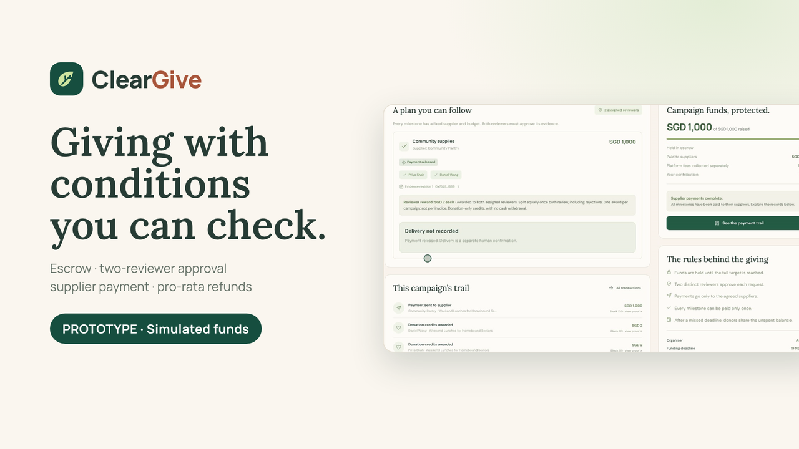
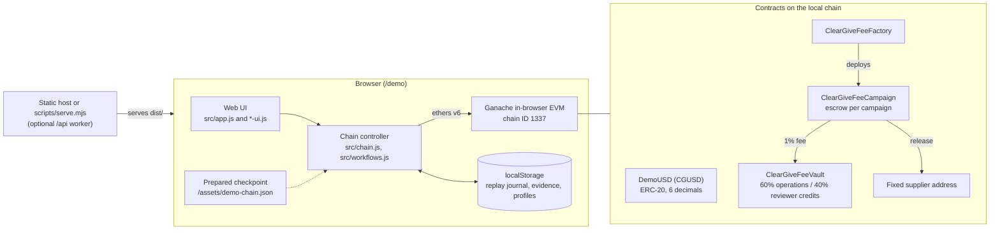

# ClearGive

**ClearGive is an Ethereum-compatible smart-contract prototype for milestone-based charitable purchasing.** Each campaign holds donations in its own escrow contract. Money goes to a fixed supplier only after the campaign is fully funded and two assigned reviewers approve the same version of the purchase evidence. Unspent principal can be reclaimed pro rata after a deadline.

The working demo runs entirely in the browser, on a **local Ganache chain (chain ID 1337)**. It uses **CGUSD**, a six-decimal ERC-20 demo token. "SGD" in the interface is a display unit only. No real money, bank, payment provider or public blockchain is involved.

> **Status: research prototype.** ClearGive was built as a student project. It has automated functional tests but **no security audit**. Do not deploy it with real funds.

## Video Demo

[](https://www.youtube.com/watch?v=rdMne-F3ydI)

Watch the narrated walkthrough (2:27) of ClearGive's donation with the 1% fee, evidence submission and two-reviewer approval, conditional supplier payment, and a separate eligible-refund scenario.

Prototype demonstration using simulated funds on a browser-local blockchain. The video was recorded from a local build of this repository; campaigns and people are fictional.

## Contents

- [Video Demo](#video-demo)
- [Use case](#use-case)
- [What is implemented](#what-is-implemented)
- [What this prototype does not establish](#what-this-prototype-does-not-establish)
- [Architecture](#architecture)
- [Quick start](#quick-start)
- [Demo walkthrough](#demo-walkthrough)
- [Repository layout](#repository-layout)
- [Generated files](#generated-files)
- [Tests](#tests)
- [Limitations and roadmap](#limitations-and-roadmap)
- [Contributing, security and licence](#contributing-security-and-licence)

## Use case

Donors to community purchasing campaigns (school supplies, food packs, equipment) often cannot see:

- what the money will be spent on;
- who controls the pooled balance;
- whether an agreed purchase actually happened.

ClearGive tests one answer to this. The spending plan, the supplier, the approval rule and the refund rule are fixed in a contract when the campaign is created. Every donation, approval and payment emits an event that anyone with chain access can inspect.

## What is implemented

The behaviour below was checked against the Solidity sources in `contracts/` and the test suite in `tests/`. It was not taken from earlier documentation.

| Area | Behaviour | Where |
| --- | --- | --- |
| Per-campaign escrow | The factory deploys one campaign contract per project. Each contract holds only its own donations. There is no organiser withdrawal function. | `contracts/ClearGive.sol`, `contracts/ClearGiveFees.sol` |
| Fixed plan | Milestones, suppliers, amounts, deadlines and the two reviewers are set at creation and cannot be changed. The factory rejects a reviewer or supplier who is also the organiser, and a supplier who is also a reviewer. | `ClearGiveCampaign` constructor |
| Funding target | Donations cannot exceed the target. Supplier payment is only possible once the campaign is **fully funded**. | `donate`, `status`, `release` |
| Evidence and approvals | The organiser records a Keccak-256 evidence hash with a revision number. Both reviewers must approve **that same hash and revision**. A rejection requires a reason hash. Evidence can only be replaced after a rejection, and replacing it resets the approvals. | `submitEvidence`, `review` |
| Supplier payment | Once a milestone has two approvals, anyone can call `release()`. The fixed amount is paid to the fixed supplier address, once per milestone. | `release` |
| Refunds | Refunds become available in two cases: the funding deadline passes below target, or the delivery deadline passes with unspent principal. `openRefunds()`, or the first `claimRefund()`, freezes the unspent balance and blocks further payments. Each donor can then claim a pro-rata share once. Principal already paid to suppliers is not refundable. | `openRefunds`, `claimRefund` |
| 1% added fee | Donating S$100 costs S$101. In one transaction, the principal goes to the campaign escrow and the fee goes to a separate fee vault. The fee is kept when refunds are paid. | `ClearGiveFeeCampaign`, `ClearGiveFeeVault` |
| Fee split and reviewer credits | The vault allocates 60% of the fee to an operations reserve and 40% to reviewer credits. The two reviewers share one award per campaign, equally, after both have taken part (rejections count). Credits can only be donated to other eligible campaigns, including the 1% fee. They cannot be withdrawn, transferred or used for the reviewer's own campaign. The operations reserve has no payout function. | `ClearGiveFeeVault` |
| Events | Donation, fee, evidence, review, release, refund and credit events are emitted and shown in the demo's ledger and receipts. | contracts, `src/` |
| Demo application | Browser Ganache, demo accounts and token allocations. Twelve prepared fictional scenarios, plus a prepared-chain checkpoint for fast start-up. Donor, organiser, reviewer and supplier views, per-donor accounting, ledger, receipts and export. | `src/`, `public/` |

There is also a separate, **inactive** public-network path:

- an XSGD-based contract (`contracts/ClearGiveXSGD.sol`);
- the root page `/` and `src/live.js` / `src/public-chain.js`;
- server-side helpers in `src/worker.js` (encrypted evidence API, payment-gateway adapter, optional classroom sharing).

These parts are tested, but they are **not configured or deployed**. The assessed demo is `/demo`.

## What this prototype does not establish

- **A local chain is not a public blockchain deployment.** The demo's chain lives in your browser and can be reset by whoever controls it. Website hosting (for example on Cloudflare Pages) does not mean a public chain is involved.
- **Role switching is not authentication or governance.** The demo's account picker and presenter controls let anyone act as any role. Two reviewer addresses do not prove two independent people.
- **A hash does not prove a document is genuine.** It only shows whether the recorded evidence later changed. **A payment does not prove delivery.** Delivery statements are separate signed, off-chain claims.
- **Refunds cover only unspent principal.** Principal already paid to suppliers, and the 1% fee, are excluded.
- **Payment needs every contract condition.** The target must be fully reached, and both reviewers must approve the current evidence revision of that milestone.
- **Reviewer credits are donation-only.** They are not cash and cannot be withdrawn.
- **CGUSD is a demo token.** It is not USD, SGD, XSGD or any redeemable stablecoin.
- **Passing tests is not a security audit.**

## Architecture



Typical flow: donor `approve` + `donate` → escrow and fee vault → organiser `submitEvidence` → reviewers `review` × 2 → anyone `release` → supplier. If a deadline lapses, `openRefunds` / `claimRefund` handle refunds.

## Quick start

Requirements:

- **Node.js 24 or newer**;
- **pnpm 11.25.0**, pinned in `package.json` as `packageManager`. The easiest way to get it is `corepack enable`, or `npm install --global pnpm@11.25.0`.

```sh
git clone https://github.com/<owner>/cleargive.git
cd cleargive
pnpm install --frozen-lockfile
pnpm build      # compiles Solidity, writes artifacts/, prepares the demo checkpoint, bundles dist/
pnpm test       # node:test suites on fresh in-memory Ganache chains (several minutes)
pnpm start      # serves dist/ at http://127.0.0.1:4173
```

Open **http://127.0.0.1:4173/demo**. Use `PORT=4174 pnpm start` if the port is taken.

Notes:

- On a fresh clone, run `pnpm build` before `pnpm test`. The tests read the generated `public/assets/demo-chain.json` (see [Generated files](#generated-files)).
- Ganache may warn that optional native `uWS` or `bigint` bindings are unavailable. It then uses its JavaScript fallback. Judge success by the test summary and exit code.
- No wallet, RPC provider, API key or cloud account is needed.

A hosted copy of the demo is at <https://cleargive.pages.dev/demo>; it was reachable when this repository was published. It is a static website that runs the same local browser chain. It is not a public blockchain deployment, and its photographs differ from the placeholders in this repository.

## Demo walkthrough

The first visit loads twelve prepared fictional campaigns. Open **Demo controls** (or `/demo?admin=1`) to switch roles, top up demo balances, or select **Prepared presentation scenarios**. `docs/DEMO-SCENARIOS.md` lists the starting totals.

1. **Donation and fee.** Fresh Groceries for Bedok Families is below target. As a funded donor, donate SGD 100: SGD 101 is deducted, SGD 100 goes to the campaign escrow and SGD 1 goes to the fee vault. The receipt shows the transaction hash, block and events.
2. **Evidence approval.** A Reading Corner for Tampines Children has revised evidence with one approval. Switch to Daniel Wong and approve the current revision. The milestone becomes ready to pay. A Safe Kitchen for Community Cooks shows rejected evidence: payment is blocked and the organiser can submit a replacement, which needs two fresh approvals.
3. **Supplier payment.** Braille Books for Young Readers is ready to pay. The fixed amount goes to the fixed supplier, not the organiser, and the same milestone cannot be paid again. School Bags for a Confident First Day shows that payment and delivery confirmation are separate.
4. **Refund.** Learning Kits for a Fresh Start collected SGD 1,000 and paid SGD 400 before its deadline passed. Alex Morgan has already received SGD 360. Switch to Mei Tan, open the campaign and claim her SGD 240. The claimable balance falls to zero, completed refunds become SGD 600, and the SGD 10 fee stays in the vault.
5. **Ledger.** Open the ledger, receipts and fixed campaign terms. These are local-chain hashes, not Etherscan transactions.

**Rebuild prepared examples** restores the scenarios; it advances the workspace clock by two days. **Reset browser demo** clears local history.

## Repository layout

```
contracts/            Solidity sources (MIT SPDX headers)
  ClearGive.sol         DemoUSD token, base escrow campaign and factory
  ClearGiveFees.sol     1% fee campaign, fee factory, fee vault and reviewer credits
  ClearGiveXSGD.sol     inactive public-network variant
src/                  browser app, chain controller, demo scenarios, accounting, worker API
public/               HTML, CSS, SVG art, placeholder images and the photo-credits page
scripts/              compile.mjs (solc), build.mjs (esbuild + checkpoint), serve.mjs, startup-checkpoint.mjs
tests/                node:test suites (*.test.mjs)
docs/                 DEMO-SCENARIOS.md, VERIFICATION.md, shared-schema.sql, presentation/
.github/workflows/    CI: install, build and test
wrangler.example.jsonc  template only; contains no account identifiers or secrets
```

## Generated files

These outputs are produced by `pnpm build` and are **not committed**. They are listed in `.gitignore`.

| Path | Produced by | Needed by |
| --- | --- | --- |
| `artifacts/contracts.json` | `scripts/compile.mjs` (solc 0.8.30) | build, tests, checkpoint |
| `public/assets/demo-chain.json` | `scripts/startup-checkpoint.mjs`, which mines the twelve fictional scenarios on an in-memory Ganache chain | fast demo start-up; `tests/startup-checkpoint.test.mjs` |
| `dist/` | `scripts/build.mjs` | `pnpm start` and static hosting |

If the checkpoint is missing, the browser falls back to creating the scenarios on first visit. The build regenerates the checkpoint whenever it is missing or no longer matches the compiled contracts. CI runs `build` before `test` for this reason.

## Tests

`pnpm test` runs `node --test tests/*.test.mjs`. Each suite starts its own in-memory Ganache chain. The suites cover:

- contract rules: funding, two approvals of the same revision, stale-evidence rejection, fixed supplier payment, duplicate-payment rejection, both refund triggers, pro-rata refunds and rounding, and factory conflict checks;
- the 1% fee: atomic transfer, rollback on insufficient allowance, the 60/40 split, retention on refunds, and reviewer credits;
- prepared scenarios and per-donor accounting, replay and resume, and checkpoint loading and fallback;
- presenter and sandbox controls, multi-tab and shared-workspace concurrency, and the inactive public-network, payment and evidence-API safeguards.

**Result for this release: 78 tests, 78 passed, 0 failed.** Details and the claim-to-test map are in `docs/VERIFICATION.md`. Earlier figures in the project history (72, 74) came from earlier code versions.

The tests do not cover:

- real browsers across devices;
- gas costs;
- adversarial security testing or formal verification;
- the public-network deployment;
- any real payment provider.

## Limitations and roadmap

Current limitations:

- The chain is local and per browser: there are no validators and no shared tamper-resistant history.
- Demo signers are Ganache's well-known deterministic test accounts, controlled by the browser. **These accounts are public; never send real assets to them.**
- There is no real identity verification, reviewer independence check, random reviewer pairing, or appeals process.
- Evidence documents are held off-chain in application storage; only their fingerprints are on-chain.
- There is no real cash collection, currency conversion, stablecoin redemption or bank payout.
- Reviewer allocations of expired, unreviewed campaigns stay in the vault. A reallocation policy is not implemented.
- Real-world pricing and operating costs (gas, payments, storage, review) are unvalidated.

Possible future work, not implemented here:

- random or independent reviewer assignment, with eligibility and reputation;
- an integrated payment provider or regulated stablecoin;
- a public testnet deployment with key management;
- an external security review and audit;
- privacy-preserving evidence handling;
- governance for disputes and reallocation.

## Contributing, security and licence

- Contributions: see [CONTRIBUTING.md](CONTRIBUTING.md).
- Security reports: see [SECURITY.md](SECURITY.md). Do not open public issues for vulnerabilities.
- Licence: the team's original code and documentation are under the [MIT License](LICENSE); see the scope note in that file. Third-party dependencies, the replaced photographs and the reference presentation are described in [THIRD_PARTY_NOTICES.md](THIRD_PARTY_NOTICES.md).
- `docs/presentation/ClearGive_Presentation.pptx` is a sanitised copy of the project presentation, kept for reference. Its speaker notes record the test count from the earlier submission (72). The current result is above.

Authored by the ClearGive Project Team.
